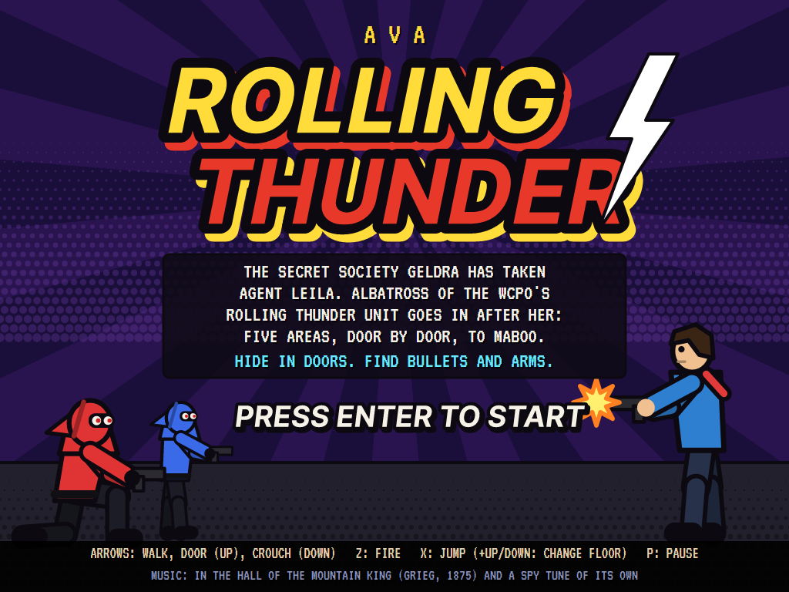
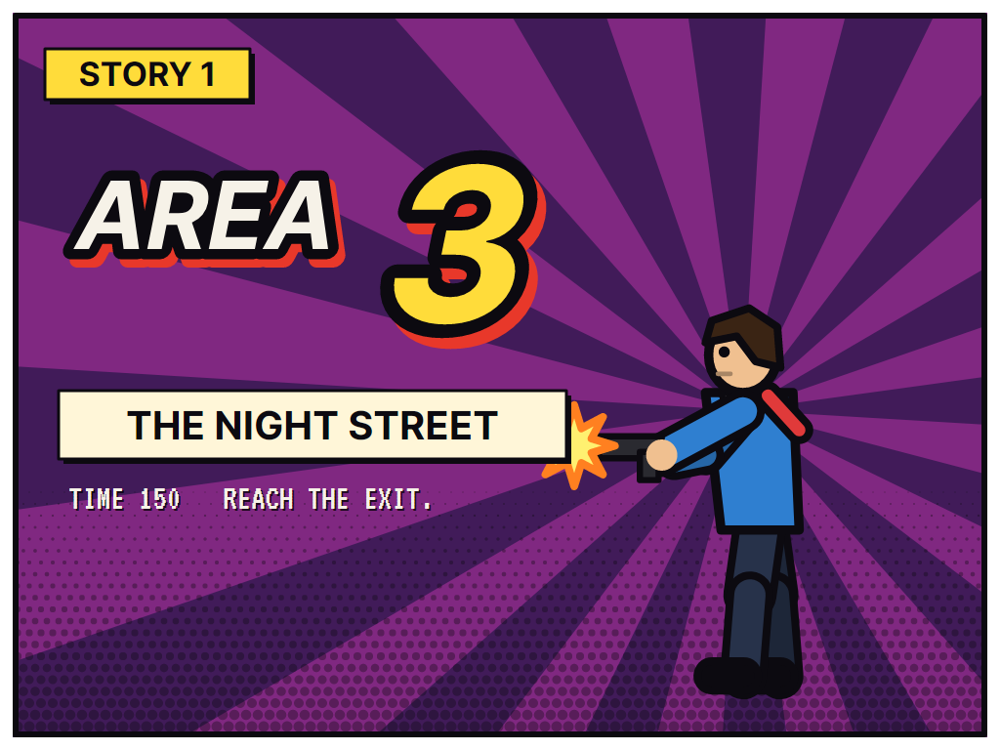
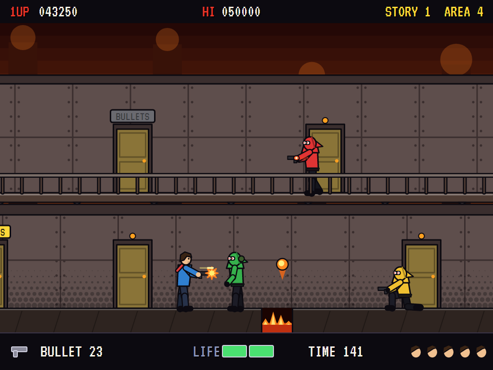
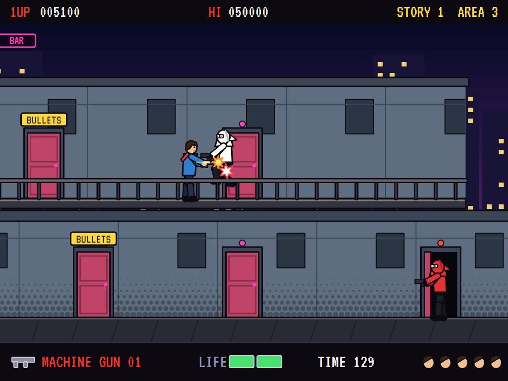
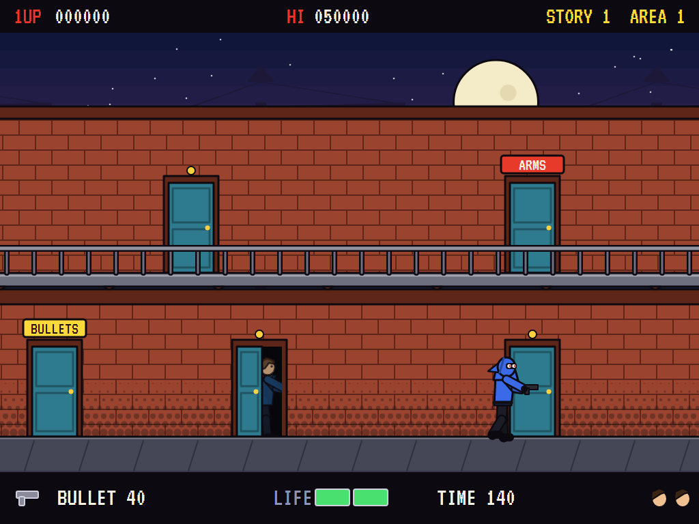
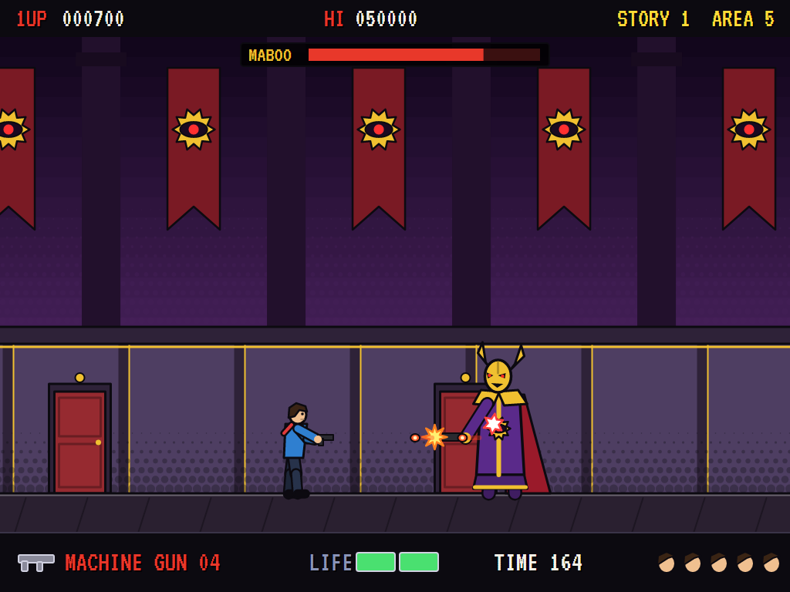
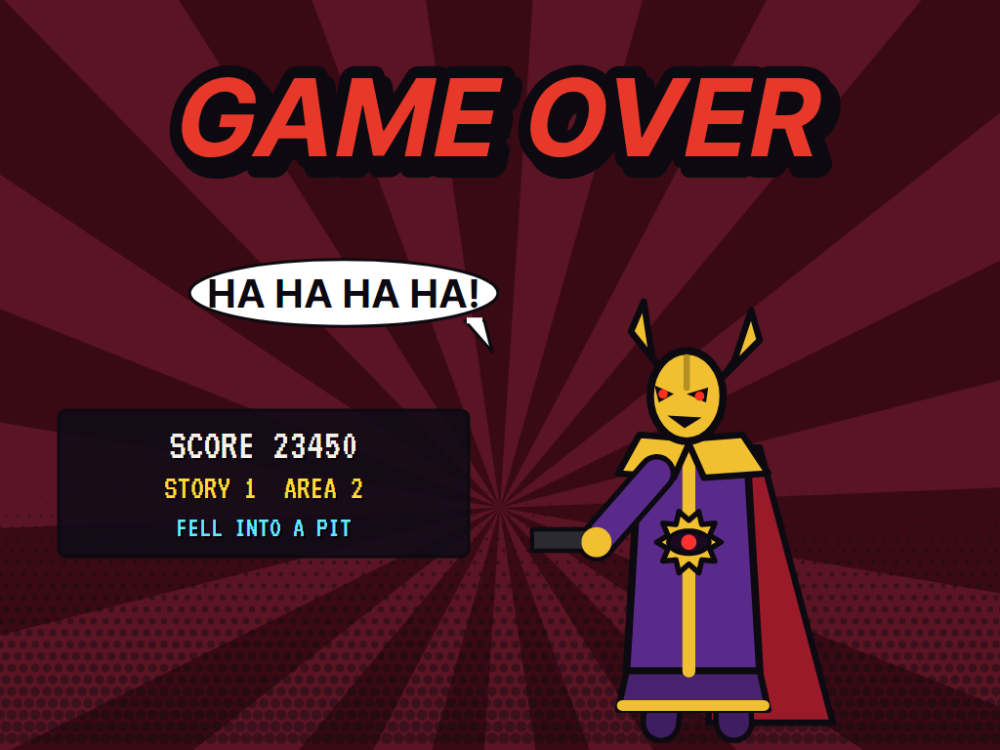
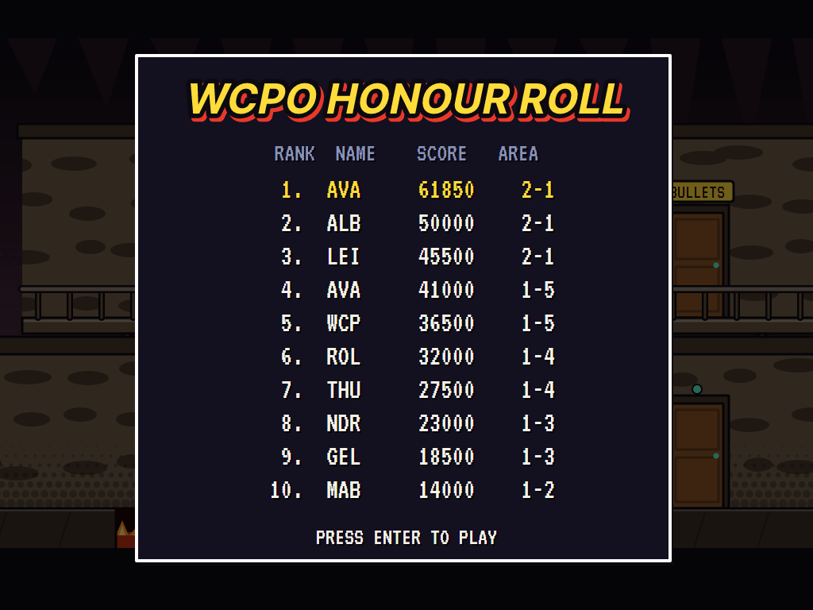

# AVA Rolling Thunder

[](https://github.com/Harlock123/AVARollingThunder/actions/workflows/build.yml)

A spy shoot-'em-up in the style of Namco's 1986 arcade game **Rolling Thunder**, built with .NET 10 and Avalonia UI.
The secret society Geldra has taken Agent Leila. Albatross of the WCPO's Rolling Thunder unit goes in after her:
five areas of doors and walkways, two storeys high, full of hooded maskers who come out of the doors to shoot,
to the Geldra's leader, Maboo. Duck the high bullets, jump the low ones, hide in the doors, find the ammunition,
and watch the clock.

## Features

- **Two storeys.** Each area scrolls by on a lower floor and, along stretches of it, an upper walkway with a
  railing. Up and jump leaps up to the walkway above; down and jump drops back down. Walk off the end of a
  walkway and you come down too.
- **Doors.** Push up at a door to duck into it and hide: bullets fly past, and the maskers walk by without seeing
  you. The clock keeps running, though. Push down (or walk off) to come out. The maskers come out of the doors
  near you, sometimes two at once, and some walk in from the edge of the screen.
- **BULLETS and ARMS.** The pistol fires once a press, one bullet in the air at a time, and you start with 40.
  A door marked BULLETS gives 15 more; a door marked ARMS gives a machine gun with 30 rounds, which fires as long
  as you hold the button. Each gives once. Out of bullets, the pistol still fires, but a slow, feeble shot.
- **One bullet kills.** A bullet takes you down whatever your life meter shows. A touch from a masker, a bat, a
  panther, a lava man, a grenade's blast or a fireball takes half of the two-part meter and knocks you back; a second
  touch is the end. The meter is full again with each new life.
- **The Geldra**, by the colour of the hood: **blue** walks up and fires; **green** lobs grenades that land where
  you stand; **yellow** drops to a crouch and fires low, so you must jump the shot; **red** leaps, at you and from
  storey to storey, and takes two hits. High shots can be ducked. In the caverns, **bats** swarm at head height; on
  the night street, **black panthers** run in under a standing shot (crouch to hit them) and pounce; in the furnace,
  **lava men** climb out of the lava pits and take four hits. **Pits** must be jumped, and **fire pits** throw up
  fireballs as you go over.
- **Five areas**, each with its own look: the docks, the caverns, the night street, the furnace and Geldra
  headquarters, each introduced by a comic-book card. Each has 150 seconds (Geldra HQ 170); the clock warns at
  30. A death puts you back at the start of the area, or halfway if you got that far.
- **Maboo** waits at the end of the last area, before Leila's cage. He wakes with a laugh, keeps his distance and
  fires in volleys of three, high or low, and every third time calls a masker out of a door. A pistol bullet harms
  him three times as much as a machine-gun round. Beat him and Leila runs to you; then **the second story**
  begins: the same five areas, with the Geldra quicker, shooting sooner, and a tighter clock.
- **Scoring:** 200 a blue masker, 300 green or yellow, 500 red; 100 a bat, 300 a panther, 500 a lava man;
  10,000 for Maboo and 20,000 for Leila; and 50 for every second left on the clock at the end of an area. Three
  agents, and another every 30,000.
- **The attract mode** shows the computer agent. Left to itself it has an agent's reflexes: it walks on, shoots
  the nearest of the Geldra in front of it (crouching for a panther), ducks the high bullets and jumps the low,
  jumps the pits and calls in at every BULLETS and ARMS door. When there's trouble near, it tries every move it has
  on a copy of the moment, each followed by those reflexes for most of a second, and takes whichever gets furthest
  and hits most without being hit. The Geldra roll the same dice in the copy, so it sees exactly what's coming. It
  frees Leila in four minutes without a death.

## Screenshots

| The title | The card | A gunfight |
|:---------:|:--------:|:----------:|
|  |  |  |
| | Before each area. | In the furnace: a grenade, a fireball, a masker crouched to fire low. |

| The walkway | Hiding | Maboo |
|:-----------:|:------:|:-----:|
|  |  |  |
| A red masker leaps. | He walks right by. | Duck the high volleys, jump the low. |

| Game over | The WCPO honour roll |
|:---------:|:--------------------:|
|  |  |

The screenshots are made by the tests, which play the game in a real (headless) window; see
[Tests](#tests).

## Download and run

Ready-to-run builds for Windows, macOS and Linux, on both Intel/AMD and ARM, are on the
[Releases page](https://github.com/Harlock123/AVARollingThunder/releases/tag/latest). **Latest build** is
rebuilt on every push to `main`. Each download is one self-contained executable: no .NET install is
needed.

| Platform | Archive |
|---|---|
| Windows | `AVARollingThunder-win-x64.zip`, `AVARollingThunder-win-x86.zip`, `AVARollingThunder-win-arm64.zip` |
| macOS | `AVARollingThunder-osx-arm64.tar.gz` (Apple silicon), `AVARollingThunder-osx-x64.tar.gz` (Intel) |
| Linux | `AVARollingThunder-linux-x64.tar.gz`, `AVARollingThunder-linux-arm64.tar.gz`, `AVARollingThunder-linux-arm.tar.gz` |

```bash
tar -xzf AVARollingThunder-linux-x64.tar.gz     # or linux-arm64, linux-arm, osx-arm64, osx-x64
./AVARollingThunder
```

On Windows, unzip and run `AVARollingThunder.exe`. On macOS, if Gatekeeper refuses to open it, run
`xattr -d com.apple.quarantine AVARollingThunder` once. Run with `--no-audio` for silence.

**Sound** comes through OpenAL Soft, built in for every platform. In a virtual machine the game
detects it and uses a larger audio buffer, so the sound doesn't break up.

**Gamepads** use SDL2, which is bundled for Windows, macOS and Intel/AMD Linux. ARM Linux builds need it
installed; without it the keyboard still works:

```bash
sudo apt install libsdl2-dev            # Debian / Ubuntu / Raspberry Pi OS
sudo pacman -S --needed sdl2-compat     # Arch / Omarchy
```

## Controls

| Action | Keyboard | Gamepad |
|---|---|---|
| Start | Enter or 1 (or fire on the title) | Start |
| Walk | Left/right arrows, or A/D | Left stick / D-pad |
| Into a door (hide, collect) | Up (W) at the door | Stick / D-pad up |
| Crouch; out of a door | Down (S) | Stick / D-pad down |
| Fire | Z or Ctrl | A (or X) |
| Jump | X or Space | B (or Y) |
| Up to the walkway / down from it | Up + jump / down + jump | Up or down + B |
| Pause | P or Esc | Start |
| Sound on/off | M | |
| Screenshot | Ctrl+S (to your Pictures folder) | |

Crouched, left and right turn you without moving. On the high-score table, type your initials, or use up/down and
Space, then Enter.

## Tests

```bash
dotnet test AVARollingThunder.slnx
```

The game runs in fixed 60 Hz steps, so it plays the same at any frame rate. Everything that changes lives in
one world that can be copied, and the tests check a copy plays out exactly the same. They also check:

- **Moving:** walking, and crouching to stop; up and jump to the walkway and down and jump back, an ordinary jump
  where there's no walkway above; walking off the walkway's end; a pit the end, and a jump clearing it.
- **Doors:** hiding from a bullet and a masker's touch, and coming out; BULLETS giving once and ARMS the machine
  gun; maskers coming out of doors near the agent but never the one he's in.
- **The guns:** one pistol bullet in the air at a time; the slow shot when the bullets run out; the machine gun
  firing while held and back to the pistol when its rounds run out.
- **Bullets and touches:** one bullet killing a full life meter; ducking a high shot and jumping a low one; one
  touch taking half the meter and a second the rest; grenades and fireballs draining rather than killing; the fire
  pits.
- **The Geldra:** points by hood, and two hits for a red one; a masker walking up, aiming and firing; a panther
  running under a standing shot; the bats' cue and the lava man.
- **The way through:** the clock's warning and running out; the exit and its time bonus; starting again from
  halfway; Maboo waking, barring the way, taking three times the harm from a pistol bullet, firing high and low,
  and freeing Leila; the second story, harder; the area cleared and the next card.
- **The game:** three deaths and the end, and a high score entered; an extra agent at 30,000; the demonstration
  and the high scores; starting; pausing; the keys through the input handler (up and jump goes up the screen);
  every area laid out fairly; every sound present.
- **The computer agent** freeing Leila in the first story without a death; walking on and firing without
  ducking never does.

`tests/AVARollingThunder.Tests/PilotProbe.cs` reports how the computer agent gets on, for tuning
(`THUNDER_PROBE=1` for the first story, `2` for both). It frees Leila in the first story in 239 seconds of play
without a death, and gets through both stories in nine minutes, losing three agents in the second.
`THUNDER_PROBE=blind` walks on firing, jumping only the pits: it dies thirty times without getting out of the
caverns.

The screenshot tests draw the real screen in a headless window. To refresh the README's pictures:

```bash
THUNDER_SHOTS=$PWD/Images dotnet test tests/AVARollingThunder.Tests --filter ScreenshotTests
```

## Building

```bash
dotnet build AVARollingThunder.slnx
dotnet run --project src/AVARollingThunder
```

Needs the .NET 10 SDK. The sounds, music and voices are made by `tools/make_sounds.py` (standard-library Python,
with the formant voice in `tools/speech.py`): `python3 tools/make_sounds.py` rewrites
`src/AVARollingThunder/Sounds`.

## Project structure

```
AVARollingThunder/
├── AVARollingThunder.slnx
├── src/AVARollingThunder/
│   ├── Engine/
│   │   ├── GameEngine.cs        # States, lives, the areas' cards, the clears, the rescue, the two stories
│   │   ├── Sim.cs               # The agent, the doors, the guns, bullets, grenades and fireballs, the clock
│   │   ├── Sim.Foes.cs          # The maskers and their doors, bats, panthers, lava men, fire pits, Maboo
│   │   ├── Stage.cs             # The five areas, each laid out from three rows of text
│   │   ├── World.cs             # The agent, the Geldra and everything that changes, kept so it can be copied
│   │   ├── Pilot.cs             # The computer agent (the demonstration, and the tests)
│   │   ├── HighScoreTable.cs, InitialsEntry.cs
│   │   ├── InputHandler.cs, ControllerManager.cs  # Keys and an SDL2 gamepad
│   │   └── SoundManager.cs      # Effects, music and voices through OpenAL
│   ├── Audio/                   # The OpenAL engine (from the author's AVABand)
│   ├── Views/GameCanvas*.cs     # The areas, the doors, the figures, the cards and the title, in comic-book style
│   └── Sounds/                  # The synthesised effects, music and voices
├── tests/AVARollingThunder.Tests/  # Gameplay and screenshot tests
├── tools/make_sounds.py, tools/speech.py
└── Images/                      # Screenshots
```

## About and licence

AVA Rolling Thunder © 2026 Lonnie Watson, under the [MIT License](LICENSE).

*Rolling Thunder* © 1986 Namco (now Bandai Namco Entertainment); the name *Rolling Thunder* belongs to its owner.
AVA Rolling Thunder is an independent, unofficial game in its style. Its graphics, sounds and code are its own;
nothing is taken from the original game's program, graphics or sound. It is not affiliated with or endorsed by
Bandai Namco or any other rights holder. The title music is *In the Hall of the Mountain King* from Edvard
Grieg's *Peer Gynt* (1875), which is in the public domain; the spy tune in play is the game's own.
